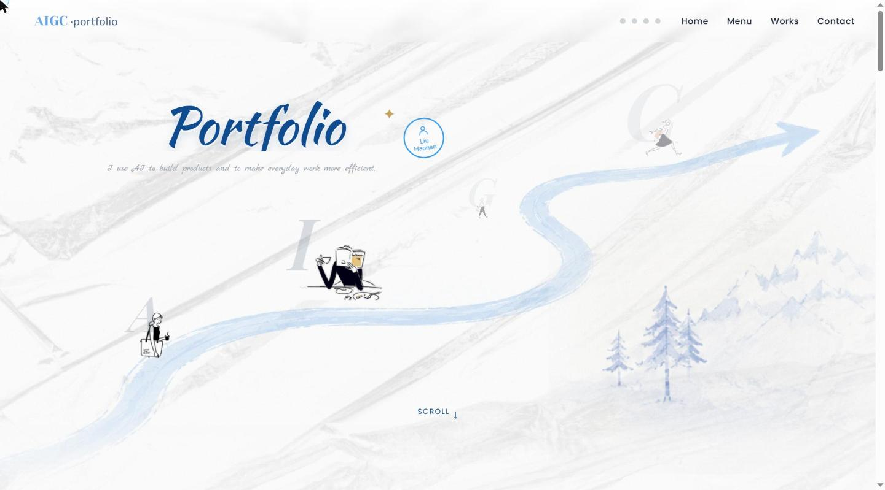

# Nora Liu · AIGC Portfolio

一个专注 AI 原生工作流的产品设计作品集，涵盖 AI 产品案例复盘、AI Workflow demo 与 AI 辅助创意实践。

---

---

## 关于这个项目

- 单文件 HTML/CSS/JS 构建，无需额外依赖，直接打开 index.html 即可查看
- 包含多个可交互的 AI Workflow demo（如周报自动生成、YouTube 评论洞察简报等），点击按钮即可看到真实生成效果
- 涉及真实项目背景的案例会明确标注数据是否为示意/个人推演，不冒充未参与的真实工作成果
---

## Tech Stack

HTML · CSS · JavaScript（原生，无框架）
